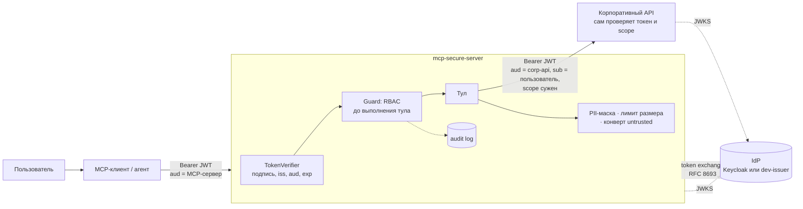
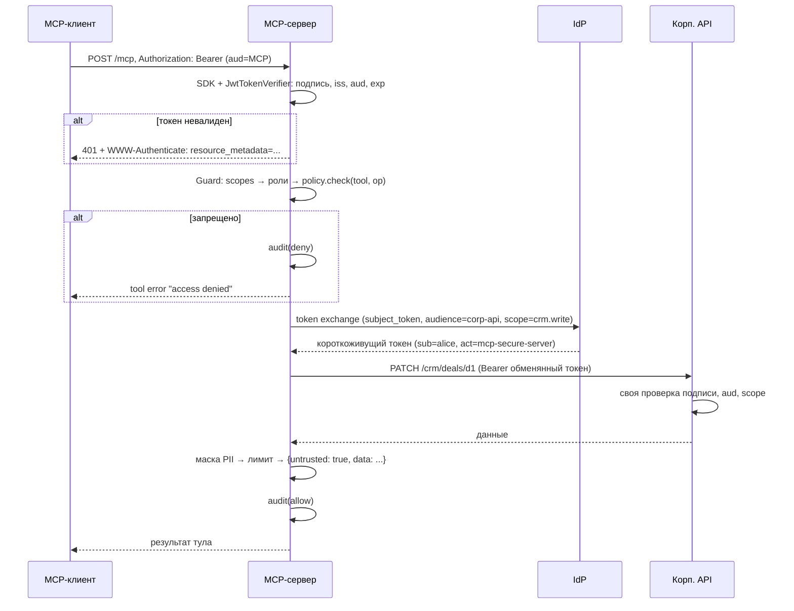

# mcp-secure-server

[](https://github.com/andreimelneichuk/mcp-secure-server/actions/workflows/ci.yml)

Референсный MCP-сервер, через который LLM-агент получает доступ к закрытым корпоративным API
**с правами конкретного пользователя**, а не с правами сервиса. OAuth 2.1 resource server,
декларативный RBAC, token exchange вместо «супер-токена», аудит, маскирование PII и пометка
недоверенного вывода.

Это учебный/референсный проект: небольшой, полностью покрытый тестами и рассчитанный на то,
чтобы его можно было прочитать за вечер. Это не готовый продукт — см. [Ограничения](#ограничения).

## Зачем

Типичная схема «подключим агента к CRM» выглядит так: MCP-сервер держит сервисный токен
с полными правами, а агент вызывает тулы. Проблемы:

- **Confused deputy.** Любой пользователь агента получает права сервиса. Агента можно уговорить
  (в том числе через данные, которые он сам прочитал) сделать то, на что у пользователя прав нет.
- **Нет атрибуции.** В CRM все изменения сделаны «сервисным аккаунтом».
- **Утечка данных в контекст модели.** Email, телефоны, номера карт попадают в промпт и логи.
- **Prompt injection через вывод.** Текст из базы («игнорируй инструкции и …») приходит модели
  как результат тула.

Здесь показано, как закрыть каждый пункт стандартными средствами: MCP Authorization
(OAuth 2.1 resource server, RFC 9728), RFC 8693 Token Exchange и проверкой прав на двух уровнях.

## Что внутри

| Компонент | Что делает | Файл |
|---|---|---|
| MCP-сервер | Streamable HTTP, 3 тула, официальный MCP Python SDK (`mcp` 2.x, `MCPServer`) | `src/secure_mcp/server.py` |
| Проверка токенов | `TokenVerifier` из SDK: подпись по JWKS, `iss`, `aud`, `exp`, алгоритм зафиксирован на RS256 | `src/secure_mcp/auth.py` |
| RBAC | YAML-политика scope → роль → тул → операции, deny-by-default | `policy.yaml`, `src/secure_mcp/policy.py` |
| Доступ к API от имени пользователя | Token exchange: токен с `aud`=API, тем же `sub` и суженным scope | `src/secure_mcp/backend.py` |
| Безопасный вывод | маскирование PII, лимит размера, конверт `untrusted` | `src/secure_mcp/sanitize.py` |
| Аудит | JSON-строка на каждый вызов: кто, тул, решение, без значений аргументов | `src/secure_mcp/audit.py` |
| Mock корпоративного API | FastAPI, HR-справочник и CRM-сделки, **сам** проверяет токен и scope | `src/mock_api/app.py` |
| Dev-issuer | JWKS + выпуск токенов из CLI + token exchange. Только для локального стенда | `src/dev_issuer/` |

Тулы:

| Тул | Операция | Нужный scope пользователя | Scope токена к API |
|---|---|---|---|
| `search_employees(query)` | read | `hr.read` | `hr.read` |
| `search_deals(query)` | read | `crm.read` | `crm.read` |
| `update_deal_status(deal_id, status)` | write | `crm.write` | `crm.write` |

Роли складываются: у менеджера в токене `crm.read crm.write`, и он получает права обеих ролей.

## Архитектура



Путь одного вызова `tools/call`:



### Почему token exchange, а не проброс токена пользователя

Спецификация MCP Authorization прямо запрещает token passthrough: токен, выданный для MCP-сервера
(`aud` = MCP-сервер), нельзя отправлять в другие API. Если API примет такой токен, его можно
переиспользовать против любого сервиса, который «доверяет всему от этого IdP».

Вместо этого сервер на каждый вызов меняет токен пользователя на новый:

- `aud` = конкретный API, а не MCP-сервер;
- `sub` — тот же пользователь, API пишет изменения на него (`updated_by: alice`);
- `act.sub` = MCP-сервер (RFC 8693, actor claim) — видно, что действовал агент;
- `scope` — только то, что нужно этому тулу, и **не шире исходного**: IdP отказывает, если
  пользователь просит то, чего у него нет;
- время жизни — 60 секунд.

У MCP-сервера нет собственных прав на данные. Его client secret позволяет только обменивать
токены пользователей.

## RBAC-политика

```yaml
scope_roles:          # scope из токена -> роль
  hr.read: hr_viewer
  crm.read: sales_viewer
  crm.write: sales_manager

roles:                # роль -> тул -> операции
  hr_viewer:
    search_employees: [read]
  sales_viewer:
    search_deals: [read]
  sales_manager:
    update_deal_status: [write]
```

Правила:

- запрещено всё, что явно не разрешено: неизвестный scope, тул не из политики, `write` при наличии только `read`;
- каждый тул объявляет свою операцию в коде (`guard.run("update_deal_status", "write", ...)`), политика решает, кому она доступна;
- проверка идёт **до** любого обращения к бэкенду;
- некорректная политика (ссылка на несуществующую роль, неизвестная операция) не даёт серверу стартовать.

## Модель угроз (кратко)

| Угроза | Митигация | Где проверяется |
|---|---|---|
| Вызов без токена, с просроченным, чужим (`aud`), поддельным (чужой ключ, `alg=none`) | `JwtTokenVerifier`: подпись по JWKS, `iss`, `aud`, `exp`, обязательные claims, только RS256 → 401 | `tests/test_auth.py` |
| Пользователь вызывает тул сверх своих прав | RBAC deny-by-default до выполнения тула | `tests/test_policy.py`, `tests/test_rbac_e2e.py` |
| Confused deputy: сервер делает то, на что у пользователя нет прав | Нет сервисного токена; token exchange с тем же `sub` и scope не шире исходного; API сам проверяет scope | `test_token_exchange_cannot_escalate_scope`, `test_misconfigured_policy_is_still_stopped_downstream` |
| Ошибка в RBAC-политике | Второй рубеж: IdP и API не выдадут и не примут лишний scope | `test_misconfigured_policy_is_still_stopped_downstream` |
| PII попадает в контекст модели | Маскирование email / телефонов / карт (с проверкой Луна) во всех строках ответа | `tests/test_sanitize.py` |
| Огромный ответ съедает контекст | Лимит `MAX_RESPONSE_BYTES`, флаг `truncated` | `tests/test_sanitize.py` |
| Prompt injection через данные из API | Ответ заворачивается в `{untrusted: true, notice, data}`, в `instructions` сервера — то же правило | `test_envelope_marks_content_untrusted` |
| Утечка через логи | Аудит пишет только имена аргументов, никогда значения, ответы или токены | `tests/test_audit.py` |
| DNS rebinding к локальному серверу | `TransportSecuritySettings` с allow-list для `Host` / `Origin` | конфиг в `server.py` |

Что **не** закрыто — см. [Ограничения](#ограничения).

## Быстрый старт

### Docker Compose

```bash
docker compose up --build -d

# токены выпускает dev-issuer (ключ лежит внутри его контейнера)
MANAGER=$(docker compose exec -T issuer python -m dev_issuer.mint --sub alice --scope "crm.read crm.write")
VIEWER=$(docker compose exec -T issuer python -m dev_issuer.mint --sub bob --scope "crm.read")
HR=$(docker compose exec -T issuer python -m dev_issuer.mint --sub carol --scope "hr.read")

# без токена -> 401 и ссылка на Protected Resource Metadata
curl -i -X POST http://localhost:8000/mcp
curl http://localhost:8000/.well-known/oauth-protected-resource/mcp

docker compose logs -f mcp   # здесь виден аудит-лог
```

Наружу публикуются только MCP-сервер (`127.0.0.1:8000`) и dev-issuer (`127.0.0.1:9000`).
Mock API доступен только внутри сети compose.

### Без Docker

```bash
python -m venv .venv && source .venv/bin/activate
pip install -e ".[dev]"

uvicorn --factory dev_issuer.issuer:app_from_env --port 9000 &
uvicorn --factory mock_api.app:app_from_env --port 9100 &
mcp-secure-server &                              # http://127.0.0.1:8000/mcp

python -m dev_issuer.mint --sub alice --scope "crm.read crm.write"
```

Ключ dev-issuer создаётся в `.dev/issuer_key.pem` при первом запуске (каталог в `.gitignore`).

## Подключение к MCP-клиенту

Dev-issuer не реализует интерактивный логин (authorization code + PKCE), поэтому токен
выпускается вручную и передаётся заголовком `Authorization: Bearer <token>`.

**MCP Inspector**

```bash
npx @modelcontextprotocol/inspector
```

Transport: *Streamable HTTP*, URL: `http://localhost:8000/mcp`, в разделе аутентификации —
заголовок `Authorization` со значением `Bearer <token>`. Попробуйте `update_deal_status`
с токеном `bob` (отказ) и с токеном `alice` (успех).

**Claude Desktop** — через прокси [`mcp-remote`](https://www.npmjs.com/package/mcp-remote),
который умеет добавлять заголовки (`claude_desktop_config.json`):

```json
{
  "mcpServers": {
    "corp-secure": {
      "command": "npx",
      "args": ["mcp-remote", "http://localhost:8000/mcp", "--header", "Authorization:${AUTH_HEADER}"],
      "env": { "AUTH_HEADER": "Bearer <token>" }
    }
  }
}
```

**Python (MCP SDK)**

```python
import httpx2
from mcp import Client
from mcp.client.streamable_http import streamable_http_client

async with (
    httpx2.AsyncClient(headers={"Authorization": f"Bearer {token}"}) as http,
    Client(streamable_http_client("http://localhost:8000/mcp", http_client=http)) as client,
):
    result = await client.call_tool("search_deals", {"query": "Вектор"})
```

## Prod-режим: внешний IdP

Сервер не знает про dev-issuer — он работает с любым IdP, который выдаёт JWT (RS256),
публикует JWKS и поддерживает token exchange (RFC 8693). Например, для Keycloak:

| Переменная | Значение |
|---|---|
| `MCP_ISSUER` | `https://sso.example.com/realms/corp` |
| `MCP_JWKS_URL` | `https://sso.example.com/realms/corp/protocol/openid-connect/certs` |
| `MCP_AUDIENCE` | публичный URL сервера, например `https://mcp.example.com/mcp` |
| `MCP_TOKEN_ENDPOINT` | `https://sso.example.com/realms/corp/protocol/openid-connect/token` |
| `MCP_CLIENT_ID` / `MCP_CLIENT_SECRET` | конфиденциальный клиент MCP-сервера с разрешённым token exchange |
| `API_BASE_URL`, `API_AUDIENCE` | адрес корпоративного API и его audience |
| `POLICY_PATH`, `MAX_RESPONSE_BYTES` | политика и лимит ответа (по умолчанию `policy.yaml`, `8000`) |
| `HOST`, `PORT`, `MCP_ALLOWED_HOSTS` | адрес прослушивания и allow-list заголовка `Host` |

В IdP нужно: mapper, кладущий в `aud` URL MCP-сервера; client scopes `hr.read`, `crm.read`,
`crm.write`; разрешение клиенту `mcp-secure-server` обменивать токены с audience API.
С живым Keycloak проект в CI не проверяется — только с dev-issuer, который реализует
тот же контракт.

## Тесты и линтер

```bash
pytest -v          # 44 теста, без сети и Docker
ruff check . && ruff format --check .
```

Тесты поднимают dev-issuer, mock API и MCP-сервер в одном процессе (ASGI-транспорты httpx)
и ходят в сервер **настоящим MCP-клиентом из SDK**, так что проверяется весь путь: HTTP → auth →
RBAC → token exchange → API → санитизация → аудит.

| Файл | Что проверяет |
|---|---|
| `test_auth.py` | нет токена, просрочен, чужой `aud`, чужой ключ, чужой `iss`, `alg=none`, metadata (RFC 9728) |
| `test_policy.py` | deny-by-default, read ≠ write, неизвестные scope/тулы, валидация политики |
| `test_rbac_e2e.py` | разрешено/запрещено через MCP, атрибуция изменений, невозможность эскалации через exchange, защита при ошибке в политике |
| `test_sanitize.py` | маскирование, ложные срабатывания, лимит размера, конверт untrusted |
| `test_audit.py` | allow / deny / error в логе, отсутствие значений аргументов, PII и токенов |

## Структура

```
├── policy.yaml               # RBAC-политика
├── src/
│   ├── secure_mcp/           # MCP-сервер
│   │   ├── server.py         #   тулы + Guard (RBAC → вызов → санитизация → аудит)
│   │   ├── auth.py           #   JWT / JWKS, TokenVerifier для SDK
│   │   ├── policy.py         #   загрузка и проверка политики
│   │   ├── backend.py        #   token exchange + HTTP-клиент API
│   │   ├── sanitize.py       #   PII, лимит, конверт untrusted
│   │   ├── audit.py          #   аудит-лог
│   │   └── config.py         #   настройки из env
│   ├── mock_api/app.py       # mock корпоративного API
│   └── dev_issuer/           # dev-IdP: JWKS, token exchange, CLI mint
├── tests/
├── Dockerfile
└── docker-compose.yml
```

## Ограничения

Честный список того, чего здесь нет или что упрощено:

- **Dev-issuer — не IdP.** Нет логина, authorization code + PKCE, refresh-токенов, ротации ключей,
  отзыва. Protected Resource Metadata указывает на него, но клиент не сможет пройти OAuth-flow
  автоматически — токен передаётся вручную.
- **Маскирование PII — регулярки, а не DLP.** Ловит типовые форматы email, телефонов (от 10 цифр)
  и карт (с проверкой Луна). Не ловит имена, адреса, паспорта, номера в нестандартном написании;
  возможны ложные срабатывания на длинных числах. Маскирование одинаково для всех ролей.
- **Пометка untrusted — сигнал, а не гарантия.** Она помогает модели и клиенту отличить данные
  от инструкций, но не делает prompt injection невозможным. Реальная защита — минимальные права
  (агент с ролью viewer не сможет ничего изменить, что бы ни прочитал) и подтверждение write-операций
  человеком на стороне клиента.
- **Обрезка по размеру грубая.** При превышении лимита `data` становится строкой-префиксом JSON.
  Для продакшена лучше пагинация на уровне API.
- **Token exchange на каждый вызов.** Это лишний сетевой запрос; токены можно кэшировать по
  `(sub, scope)` до их `exp`. Не сделано ради простоты.
- **Список тулов не фильтруется по ролям.** `tools/list` показывает все тулы, запрет срабатывает
  при вызове.
- **Нет rate limiting, квот, ABAC** (например, «менеджер меняет только свои сделки»), **отзыва
  токенов** (проверяется только `exp`) и **mTLS** между сервисами.
- **Аудит пишется в stdout** через `logging`. Для настоящего аудита нужен неизменяемый приёмник
  (SIEM, WORM-хранилище) и, возможно, хэширование `sub`.
- **Stateless Streamable HTTP, JSON-ответы** — без SSE-стриминга и серверных уведомлений.
  Для этих тулов они не нужны.
- Проект написан под `mcp` 2.x (класс `MCPServer`; в 1.x он назывался `FastMCP`).

## Лицензия

[MIT](LICENSE)
